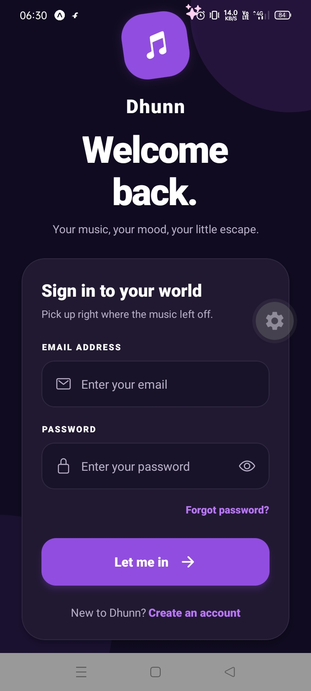
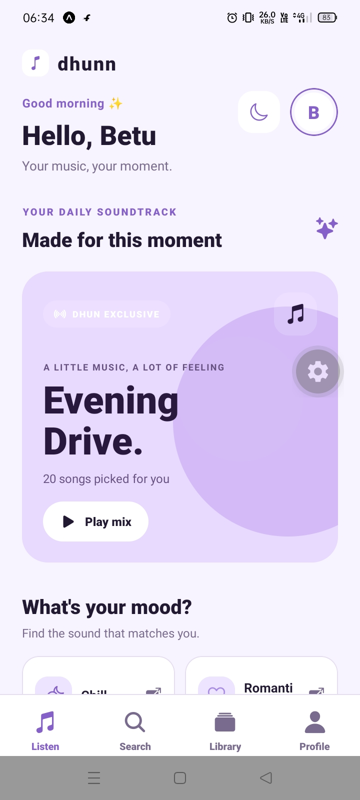
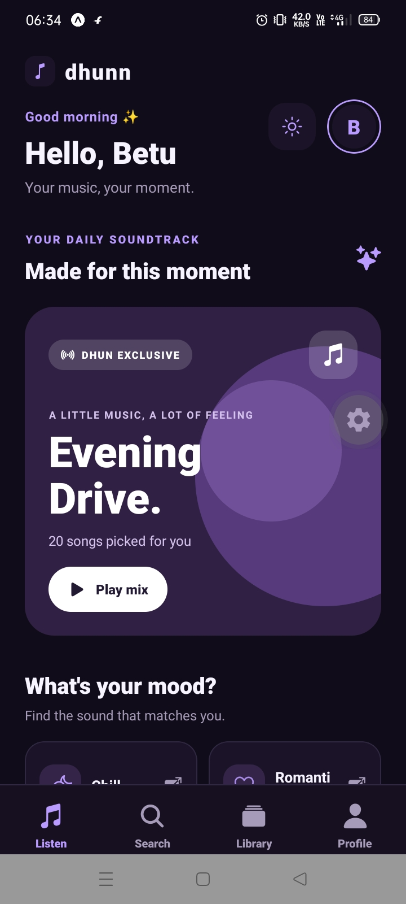
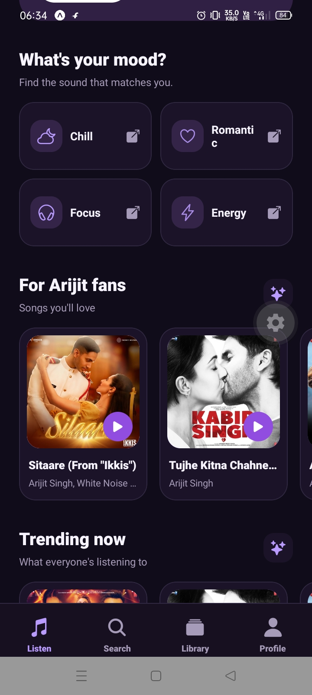
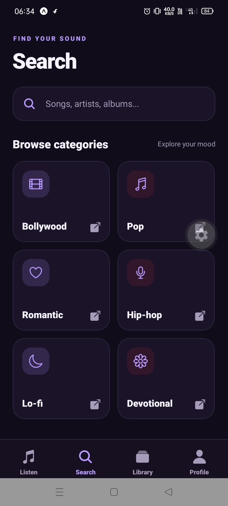
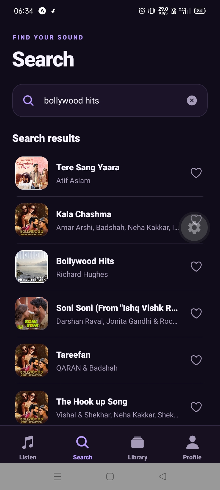
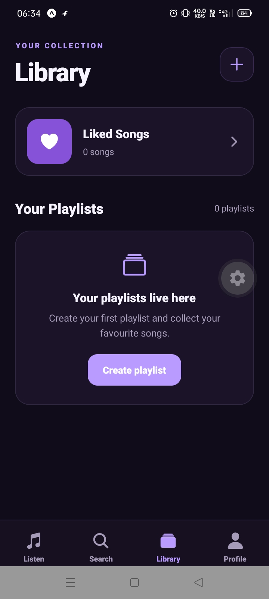
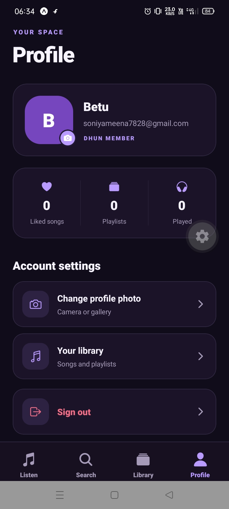

# 🎵 Dhunn – Your Music, Your Mood

<p align="center">
  <strong>A modern music player built with React Native and Expo.</strong><br/>
  Discover music, explore songs, manage your playlists and enjoy a personalized listening experience.
</p>

<p align="center">
  
  
  
  
</p>

## 📱 Download APK

Try the latest Android version of Dhunn:

**[⬇️ Download Dhunn APK](https://expo.dev/artifacts/eas/955LdLG11CgGFOoISMUzZNmG11T0sNn2KBUJiIdWHkg.apk)**

> Download the APK, install it on your Android device and start listening.

---

## ✨ Features

- 🎧 **Music Discovery** – Explore and discover songs.
- 🔍 **Smart Search** – Search for tracks and explore music categories.
- ▶️ **Music Player** – Play, pause, skip and control playback.
- ❤️ **Liked Songs** – Save your favourite tracks.
- 📂 **Playlist Management** – Create, manage and organize playlists.
- 🌙 **Dark & Light Mode** – Switch between beautiful themes.
- 👤 **User Profile** – Manage your profile and view listening statistics.
- 🔐 **Authentication** – Login, signup and password reset screens.
- 🎨 **Modern UI** – Premium purple and lavender-inspired interface.

## 🖼️ App Screenshots

### 🔐 Authentication

<p align="center">
  
</p>

### 🏠 Home Experience

<p align="center">
  
  
  
</p>

### 🔍 Music Discovery

<p align="center">
  
  
</p>

### ❤️ Your Library

<p align="center">
  
</p>

### 👤 User Profile

<p align="center">
  
</p>

---

## 🛠️ Tech Stack

| Technology        | Purpose                        |
| ----------------- | ------------------------------ |
| React Native      | Mobile application development |
| Expo              | Development and build platform |
| TypeScript        | Type-safe development          |
| Expo Router       | File-based navigation          |
| React Context API | Global state management        |
| AsyncStorage      | Local data persistence         |
| Ionicons          | Application icons              |
| Expo Image Picker | Profile photo selection        |

## 📁 Project Structure

```text
dhunn/
├── assets/
│   └── images/
├── screenshots/
├── src/
│   ├── app/
│   │   ├── (tabs)/
│   │   ├── playlist/
│   │   ├── login.tsx
│   │   ├── signup.tsx
│   │   ├── forgot-password.tsx
│   │   └── now-playing.tsx
│   ├── components/
│   ├── constants/
│   ├── context/
│   ├── hooks/
│   ├── services/
│   └── types/
├── app.json
├── eas.json
├── package.json
└── README.md
```

## ⚙️ Installation & Setup

### 1. Clone the repository

```bash
git clone https://github.com/soniya1610/dhunn.git
```

### 2. Navigate to the project

```bash
cd dhunn
```

### 3. Install dependencies

```bash
npm install
```

### 4. Start the Expo development server

```bash
npx expo start
```

Follow the Expo CLI instructions to run the app on your device or emulator.

## 🏗️ Build APK

To generate an Android APK using EAS Build:

```bash
eas build -p android --profile preview
```

## 👩‍💻 Developer

**Soniya Meena**

- GitHub: [@soniya1610](https://github.com/soniya1610)
- Project: [Dhunn](https://github.com/soniya1610/dhunn)

---

<p align="center">
  Made with ❤️ and 🎵
  <br/>
  <strong>Dhunn – Feel Every Beat.</strong>
</p>
